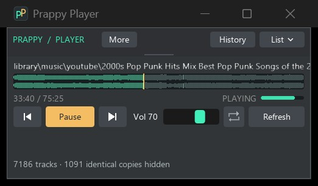
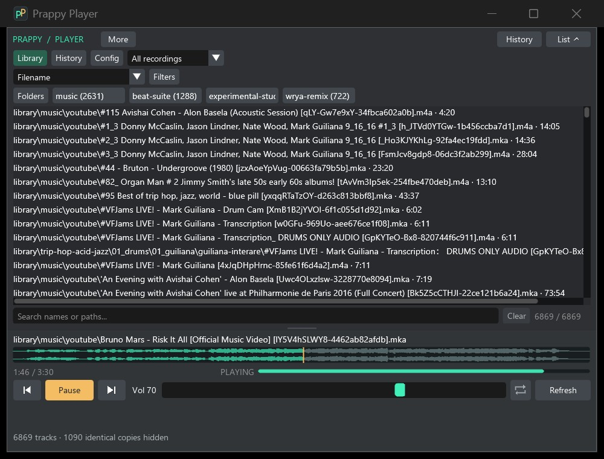

# Prappy Player

<p align="center">
  
</p>

Compact Windows x64 music player: SDL3, Dear ImGui and audio-only libmpv.
Defaults to **500 physical pixels** of content width (also the minimum), with
18px text and adjustable width and height. Starts with
the list collapsed on first launch; playback controls always stay at the bottom.
Subsequent launches restore search, browsing filters and included/hidden folders,
sort/grouping and collapsed groups, the Library/History tab, List expansion,
scroll position, folder-browser location/search, and window position, size and
maximization. Strip mode also remembers the previous normal window height.
These join volume, normalization, topmost, panel height, pinned folders and
playback/history state in the existing saved settings. Older settings files
remain readable. Window geometry is fitted to an available monitor on restore.
The UI uses SDL's Direct3D 11 renderer for hardware-accelerated drawing at 4K.
Input, ImGui and rendering stay on the window thread, with one queued GPU frame;
audio seeking and library analysis run independently. Paused idle stays event driven.

Filenames use DirectWrite shaping, Windows font fallback and a bundled Noto CJK
font. CJK scripts, supplementary Unicode characters and color emoji work in
library/history rows, the current title and path tooltips. Highlighting follows
shaped clusters, preserving emoji sequences and combining marks. The search box
uses a 32-bit FreeType font atlas; Windows displays IME composition and candidates
at the text cursor. Composition Enter, Escape and Space are reserved for input.

The paused player waits for events and redraws only when needed, including caret
blinks and delayed tooltips. Playback remains animated; worker completions and
audio events wake the UI, including while minimized. Meter decay and normalization
ramps use elapsed time. Text layouts are shared across measurement, colors and
highlights; separate raster caches retain up to 64 MiB of visible text tiles.
Evicted textures are retired after the frame using them is presented. A recovered
graphics-device reset rebuilds text, waveform and font textures without restarting
audio playback.

Seeking queues work asynchronously on mpv's thread and coalesces waiting targets.
The marker follows clicks immediately and interpolates between playback updates;
input redraws immediately while playback animation targets 60fps. The thin stereo
waveform uses ImPlot with cached envelopes bounded by horizontal resolution.
The sampling editor shares the stereo plot primitive and adds exact PCM detail. Decoder position, duration,
pause and meter updates arrive through mpv events without per-frame property reads.

NVIDIA's overlay can mistake a GPU-rendered desktop app for a game. The optional
`scripts/set-nvidia-profile.ps1 -Apply` writes the undocumented per-executable
exclusion `0x809D5F60=0x10000000` for `PrappyPlayer.exe`. Run it in an administrator
PowerShell, then restart the player. It exports all profiles to `build/` before
writing, refuses shared/predefined profiles and reads the value back. Omitting
`-Apply` only checks the value. The player never changes driver settings itself;
global overlay and notification settings remain untouched. This workaround is
driver-dependent and may need reapplying after updates.

`scripts/measure-ui.ps1` compares isolated software and Direct3D 11 test windows
at compact and 4K sizes, including scrolling and an expanded waveform. It records
frame phases, text cache activity and accepted-input-to-Present timing in
`build/ui-performance.json`, and checks for known overlay modules. These CPU
timings are not measured display/photon latency. Software rendering is available
only through the explicit test-window comparison, with no production fallback.

## Catalog, history and repeat

The catalog is saved as `player-catalog.bin` beside `player.ini`. A compatible
snapshot is usable immediately while one background refresh checks for changes.
Catalog format version 1 is independent of the executable/product version:
rebuilding or updating the player does not invalidate it. Root/extension changes
require reconciliation. Offline roots retain cached tracks, marked **Offline**,
until they return. The first scan still has to finish before a cache exists.

History is stored separately in `player-history.txt`. The default retains
10,000 successfully loaded visits. To change it, add this to `player.ini`, then
click Refresh (valid range: 1–1,000,000):

```ini
history_limit=10000
```

**History** in the compact header opens a searchable list of visits, newest
first, with paths and played times. Library and History buttons switch views.
Repeated deliberate selections create separate visits; pause, seeking and
Back/Forward traversal do not. Clicking an old history row starts it from the
beginning as a new visit. Unavailable paths are marked after a failed attempt;
history remains available even while the catalog is scanning or a root is offline.

The library's view selector offers **Unplayed**, **Most played** and **Last played**.
These use retained successful visits, combine identical-copy paths, and exclude
pending queue entries. Counts are not lifetime statistics: a track can become
Unplayed again after its visits age out of the configured retention limit.

**Folders** provides directory filtering without opening every directory group.
The single row adapts to the available width: active includes and exclusions first,
then pinned folders and top-level folders ranked by recording count. Long names
use an ellipsis; full paths appear on hover. **+N more** opens a scrollable overview
of the priority folders. Click several chips to include their subtrees together;
click an excluded folder to unhide it. Open **Folders** to browse one level at a time, search
that level, include folders, hide whole subtrees, or pin useful subdirectories.
Counts combine identical copies without counting the same recording twice in a
parent folder. Overlapping configured roots share one tree.

Includes are temporary and reset at launch. Hidden directories and pins are
saved in `player-ui.txt`; hidden ancestors take precedence over included children.
**All folders** clears includes while keeping exclusions, **Clear hidden** removes
exclusions, and the row's **Reset** clears both. Search, history views, file-type
and duration filters combine with directory filters. If an identical recording
has an allowed copy outside a hidden folder, the visible row plays that copy.
These are browsing filters; the queue, trail and **Play/Repeat this folder**
continue to determine automatic playback progression.

**Back** returns to the preceding visit. **Next** follows forward history first,
then library order. After A → B → C, Back returns to B and Next returns to C.
Choosing D while at B makes the navigation trail A → B → D; C stays searchable
in the full history. Hover the arrows to see their destination. Failed loads do
not commit navigation or create visits; the previous recording is restored when
possible, with an error displayed.

The graphical repeat button cycles **Off → One → All → Off**. One repeats only
the current track on natural EOF; explicit navigation still works. All wraps the
library sequence after forward history is exhausted. Off stops at the final
library track; explicit Next can still wrap. Failed playback is not retried in a
loop. The enabled icon uses the accent color, with a **1** mark for Repeat One;
its tooltip explains the current state and next click.

Right-click a library/history row or the current track name to **Play next** or
**Add to queue**. These insert pending slots into the existing navigation trail;
they become visits only after a successful load. Play next inserts immediately
after the current visit, ahead of forward history; Add to queue appends after
the forward trail. Repeated Play next actions put the newest selection first.
An explicit new selection branches away from played forward history while
preserving explicitly queued tracks. Failed loads leave the queued slot pending
and restore the previous recording. Rapid Next during a pending queued load
does not skip that uncommitted slot. **More** lists forward/queued tracks and
lets you remove queued slots, including cancelling a pending queued load.
Queue entries are saved with history, are excluded from visit statistics, and
have their own 10,000-track bound within the overall one-million-record limit.

The same context menu offers **Play this folder** and **Repeat this folder**.
The scope is the file's immediate parent directory, excluding subdirectories.
Folders containing only hidden identical copies remain playable using those
copies' paths, without duplicating the library entries.
Fallback Next/EOF progression uses that directory in the selected library order;
Repeat All wraps it. Explicit queued tracks and forward history take priority,
including paths outside the folder. The status line shows the active scope;
**More → Play all folders** clears it. Folder scope and repeat restore on restart.

Restarting restores the selected visit, position, navigation trail and repeat
mode **paused**. Completed recordings restart at zero. State is checkpointed on
track/navigation changes and pause, about every 15 seconds during playback, and
on close. A crash can lose changes since the last checkpoint. Checked temporary
file replacement and backups protect the previous snapshot; errors appear in
the status line. History accepts UTF-8 with LF or Windows CRLF and an optional
BOM. Recovery tries the backup, then valid independent records, preserving a
damaged original. Unsupported newer history formats are preserved without writes.
Snapshots are bounded to 128 MiB, with bounded records and lengths.

## Memory and robustness checks

Player code builds with C++20, `/W4 /WX /permissive-`; warnings fail the build.
Third-party libraries keep their own warning policies.

```powershell
# Build and verify Release, static analysis, Debug leaks and Debug ASan.
pwsh scripts/verify-health.ps1
# Repeat tests against existing diagnostic builds.
pwsh scripts/verify-health.ps1 -SkipBuild
# Build/test beside a running Release player without replacing its executable:
pwsh scripts/verify-health.ps1 -VariantSuffix Features
# Individual diagnostic builds:
pwsh scripts/build.ps1 -Analyze
pwsh scripts/build.ps1 -Config Debug -Asan
```

The health check compiles the static-analysis variant and runs playback/dedup/search
regression tests twice each against Release, Debug and Debug ASan,
including 12 playback lifecycle, refresh and scan cancellation cycles per run,
then verifies catalog/history persistence, recovery, repeat, and native window
behavior. Feature UI tests use explicit test-window input acknowledgements and
observed hover/press/activation/state changes, rather than fixed timing sleeps.
They also check tooltip text and saved files. Logs live in `build/`.
Debug CRT leak reports are checked automatically; for a manual Debug session set
`PRAPPY_LEAK_REPORT` to an absolute log path before launching and close normally.
Without that variable, leak diagnostics go to the debugger. Release omits the
leak reporter. ASan instruments the player, SDL and ImGui, and the build script
copies its required runtime DLL beside the diagnostic executable.

MSVC ASan detects memory misuse, not leaks. CRT reports cover allocations in the
Debug CRT used by this executable; the prebuilt mpv DLL has separate allocation
and instrumentation coverage. These checks cannot prove absence of all leaks,
Win32 handle leaks or concurrency bugs. If memory or handles keep growing after
warm-up during a longer playback/refresh session, investigate with heap snapshots
or a profiler. The automated playback check needs a working Windows audio device;
window checks need an interactive desktop.

## Screenshots

Keep the list tucked away for playback in a small window.



Widen the window and open the list to browse tracks by their relative paths.
The playback controls stay at the bottom.



## Build and run

PowerShell 7, MSVC 2022 C++ Build Tools / Windows SDK, CMake 3.25+ and Ninja.
The shared toolchain setup is in `dotfiles_private/windows/bootstrap_windows`.
Set `DOTFILES_PRIVATE` if that checkout is not beside this repository or under
`$HOME/projects`. No bgfx, shader compiler, submodules or package manager needed.

```powershell
cd C:\Users\Home\projects\prappy\apps\prappy-player
pwsh scripts/deps.ps1          # first checkout: download the pinned libmpv DLL
pwsh scripts/build.ps1 -Run    # Release; add -Config Debug for a debug build
```

Executable: `build/Release/PrappyPlayer.exe`. Launch it directly without a
console, including from Explorer. To relocate it, copy the executable,
`PrappyPlayer.ico`, `libmpv-2.dll`, `licenses/`, `player.ini`, `player-ui.txt`, `player-history.txt`
and `player-catalog.bin` together, including their `.bak` files if present. The MSVC runtime and
SDL are statically linked. Build output and the downloaded DLL are gitignored.

## Music roots

On first launch, the player creates `player.ini` **beside the executable**, with
your Windows Music folder as the default root. Expand **List**, then **Config**
to edit it. UTF-8, one `key=value` per line:

```ini
# Examples: replace these paths with accessible Windows folders/shares.
directory=D:\Music
directory=\\ubuntu-host\music
extensions=flac,wav,mp3,opus,m4a,wv,mka,webm,ogg,aac,aiff,wma
history_limit=10000
```

Repeat `directory` for more recursive roots. Relative paths resolve against the
configuration file's directory, never the shell's working directory. Extensions
are case-insensitive, with or without leading dots. Unknown keys and malformed
entries show an error and retain the previous list. Missing roots show a warning;
valid roots still load, and cached entries from unavailable roots remain. Overlapping
roots are deduplicated. Directory junctions are not traversed. No watchers,
database, periodic rescans or media writes.

Byte-identical files also collapse into a single song entry, including renamed
copies and hard links. Hover the entry to see all its paths. The status line
reports how many copies were hidden. Same filenames with different bytes stay
separate; different encodings of the same performance also stay separate.
Hard links are recognized by file identity. Other equal-size candidates with
matching small samples receive a full-file SHA-256 check before hiding anything.
Verification is cached by path, byte length and modification time. An unchanged
catalog reuses its existing grouping after metadata enumeration; changed catalogs
reuse verification for unchanged candidates. Metadata reuse is a heuristic:
same-size edits that deliberately preserve modification times need **Shift+Refresh**
to force content revalidation. Initial or forced full-content verification can
be slower over WSL because audio crosses the Windows/Linux filesystem boundary.
No media is changed or deleted. The window shows scan/duplicate-check progress. A single
temporary scan worker runs only at startup or when Refresh is clicked; controls stay
responsive and the previous list remains usable until the new list is ready.
Closing cancels the scan. Refresh is disabled while a scan is already running.
Reopening the executable or its pinned taskbar shortcut restores the existing
player instead of launching another copy.

For **local WSL**, Windows already exposes the Linux filesystem: no network
share, SSH, copying or mapped drive is needed. This workstation's running distro
is `ubuntu26-dev`; its configured audio roots are:

```ini
directory=\\wsl.localhost\ubuntu26-dev\home\home\p\g\n\scraper\library
directory=\\wsl.localhost\ubuntu26-dev\home\home\.local\share\audioharvest\phase-02-library
extensions=flac,wav,mp3,opus,m4a,wv,mka,webm,ogg,aac,aiff,wma
```

Find your distro name with `wsl --list --verbose`. Use that name after
`\\wsl.localhost\`, followed by the Linux absolute path with backslashes.
The distro must be available. Paste the entries into the executable's
`player.ini` and click Refresh. The player reads audio in place and does not
operate the scraper, change its recordings or interfere with collection jobs.

## Controls

- **List** expands/collapses the library. Choose filename order, directory groups,
  file type groups, or duration order (unknown durations last). Rows show each track's relative path, including its
  filename. Paths under `scraper` start after that directory, for example
  `library\beat-suite\render\mix.flac`. Other roots use their folder name as
  the prefix. Hover for the same path and any identical-copy locations;
  scroll horizontally to read longer rows.
- **Search** sits below the expanded list, above playback. Type words from a
  filename or relative path to filter instantly; all words must match, in any
  order, ignoring case. Matching filenames rank above directory and hidden-copy
  matches; matching tokens are highlighted in the displayed row. Searches use
  a flat ranked list even when grouped browsing is selected. Hidden duplicate
  paths are searchable too. The count
  shows matches out of the full library. **Ctrl+F** focuses search; **Escape**
  or **Clear** clears it. Filtering keeps the playing track and playback order.
- Back, Play/Pause, Next, seek, volume and repeat are always available.
  **Space** toggles play/pause when the player has focus.
  With repeat Off, automatic progression stops after the final library track;
  explicit Next wraps after forward history is exhausted.
  Playback errors stop progression and appear in the status line.
- **Filters** offers extension, online/offline availability, minimum/maximum
  duration in seconds, and measured-duration-only filtering. Zero maximum means
  no upper bound. Active duration bounds exclude tracks awaiting analysis.
  Filters and history-derived views affect browsing; folder scope, the trail
  and queue determine playback progression.
- The seekbar draws cached stereo peaks with a gold playhead and mint played
  region. Drag anywhere to seek; keyboard focus supports Left/Right (five seconds),
  Home and End. It stays seekable while waveform analysis is pending. Display
  amplitude is scaled to the track's peak so quiet files remain readable.
  Drag the small divider above the current title upward to enlarge the waveform;
  playback buttons stay in place. Double-click the divider to restore compact
  height. A focused divider also supports Up/Down and Home. The preferred height
  is saved, clamped to fit smaller windows, and restored when there is room.
- A small meter shows live decoded sample peaks before volume/normalization,
  with a release decay. It is not a hardware-output or true-peak meter.
- Right-click a track to **Copy full path**, **Copy WSL Linux path**, or
  **Reveal in Explorer**. WSL conversion supports `\\wsl.localhost\distro\...`,
  `\\wsl$\distro\...`, and extended UNC paths, preserving Unicode and spaces.
  The WSL action is disabled for other Windows paths/shares.
- **More** contains **Always on top**, **Slim strip** and **Normalize to -18 LUFS**.
  Strip mode keeps transport, waveform and meter in 86 content pixels of height;
  use More to return. Ctrl+Shift+M toggles strip mode, and Ctrl+Shift+T toggles
  topmost. These settings, folder scope, waveform height, hidden directories and
  pins and volume use `player-ui.txt` format 3. Existing format 2 settings are
  preserved with a default volume of 70. Volume changes are saved automatically
  and restored on startup, including mute. Catalog and analysis-cache formats are unchanged.
- Sorting changes fallback library progression without reordering history.
  Refresh reloads config and scans once, preserving playback by full path.
  If the playing file disappears from the list, it can finish; Next starts at
  the first remaining track.
- **Refresh** checks roots/settings again; **Shift+Refresh** also revalidates
  duplicate contents and rebuilds audio analysis. Hover over the status for full errors.
- Hover the current track name for source codec, sample rate, channel layout,
  decoder sample format, available source bitrate, and measured duration/loudness.
  Decoder sample format is not a claim about the source's original bit depth.
- Drag any unused space, including the title and blank list/transport areas.
  Buttons, sliders, song rows, group headers and scrollbars retain normal input.
  Resize any native window edge or corner.
  The dark Windows title bar provides minimize, maximize/restore and close,
  plus the system menu and Windows 11 Snap Layouts when enabled in Windows.
  List toggles preserve your chosen width and leave maximized windows maximized.

The content uses physical pixels; Windows sizes the native frame for each monitor's
DPI. The compact layout was enlarged
from the initial 350px / 12px design at the user's request.

## Audio analysis

After a successful catalog scan, one background worker analyzes online tracks,
prioritizing the current track when it is still queued. It uses the bundled
libmpv decoder and a bounded Windows pipe, without temporary PCM files or another
installed tool. Each decode produces frame-count duration, stereo min/max peaks
at 1,024-frame resolution with successively halved levels, and gated integrated
loudness. The seekbar uses these cached peaks; only the selected track's full
peak pyramid is handed to the UI. Other tracks retain lightweight summaries.
Selecting an already analyzed track reads its cache on the same worker, without
another decode pass. No histogram view is implemented.

Analysis uses a 48 kHz floating-point **stereo render** at unity gain with
ReplayGain disabled. Its LUFS value describes that render, including mono
duplication or surround downmixing; it is not a native multichannel measurement
or a true-peak measurement. K-weighting and the 400 ms/100 ms absolute/relative
gates follow [ITU-R BS.1770-5, Annex 1](https://www.itu.int/rec/R-REC-BS.1770-5-202311-I/).
Silence and audio shorter than 400 ms have no integrated loudness value.
Playback uses a 48 kHz stereo output path matching the analysis render. When
**Normalize to -18 LUFS** is enabled, measured loudness selects a constant gain
per track, capped at +12 dB and reduced as needed for a -1 dB sample-peak ceiling.
Silence, short tracks and pending/failed analysis use zero gain. Newly available
measurements ramp toward the target during playback; a known gain is applied
while a track loads paused, before it becomes audible. The volume slider stays
independent. This preserves dynamics and does not promise true-peak limiting or
an exact target when the boost/headroom bounds apply.

The live meter uses a lightweight `astats` filter on the playback decoder; it
does not open the source a second time. Playback gain uses mpv's separate
`volume-gain` property. Playback and analysis disable automatic ReplayGain
adjustments so measured gain has one authority.

Disposable, checksummed per-track files live in `player-analysis/` beside the
executable, separately from the catalog and history. Reuse requires the same
path, byte length, modification time and analysis schema. Invalid or incompatible
files are rebuilt directly; there are no cache migration paths. Shift+Refresh
also handles edits that preserve size and modification time. Deleting this
directory safely resets analysis. It may be omitted when relocating the player;
unused entries are not automatically pruned.

The worker skips offline roots, rejects sources that change during processing,
and reports analysis failures in the current track tooltip without interrupting
playback. Closing cancels pending pipe I/O and decoding; refreshing cancels work
for a removed or changed source. Each track is bounded to eight hours, and a
decoder that makes no progress for 30 seconds is stopped. Scanning, analysis and
history saving own separate workers; their results are collected by the UI.

## Code organization and design boundaries

- `main.cpp`: Windows entry point and Debug leak reporting.
- `player_ui.cpp`, `ui_probe.h`: window, controls and acknowledged test input.
- `paths.h`, `config.h`: path handling, search normalization and settings.
- `library.h`, `catalog.h`, `scan.h`: library model, deduplication, cache and scan lifecycle.
- `audio.h`, `playback.h`: decoder access and acknowledged playback/history transitions.
- `history.h`, `paged_vector.h`, `state_io.h`: persistence and immutable paged
  snapshots. Serialization and file writes run off the UI thread. Snapshotting
  shares record pages and copies the numeric navigation trail; subsequent record
  changes detach only their affected page. Library and history searches reuse
  normalized text; sorting reuses cached names.
- `analysis.h`, `analysis.cpp`: streaming analysis, DSP, cache and cancellation.
- `browse.h`, `preferences.h`, `feature_ui.h`: retained-history views, ranked
  filtering, settings, shell actions, waveform and peak widgets.
- `directory_filter.h`, `directory_ui.h`: subtree scopes, priority directory
  indexing, pins and a clipped one-level directory browser.
- `grouped_list.h`, `transport_layout.h`: cached grouped rows and bounded,
  persistent waveform-panel sizing.
- `tests.cpp`, `analysis_tests.h`, `feature_tests.h`: playback/state, analysis,
  queue, browsing, normalization and feature regression checks.

The navigation trail contains both successful visits and explicitly queued
future slots, distinguished in the history model and persisted as `QUEUED`
records until a successful load commits them as visits. A future A/B comparison can switch
sources on one decoder while restoring the playhead; two concurrent decoders
are an optional latency/synchronization tradeoff. Loudness matching would use
measured gain separately from the comparison transport. A/B comparison is not
implemented.

## Verification

The executable includes a headless integration check, using libmpv's null audio
output. Supply a configuration containing at least two nonempty audio files:

```powershell
$p = Start-Process build/Release/PrappyPlayer.exe -WindowStyle Hidden -Wait -PassThru `
  -ArgumentList '--self-test', 'C:\absolute\test.ini', 'C:\absolute\results.log'
$p.ExitCode
```

It checks decoding once per discovered extension, duration, pause, seek, volume,
sort/refresh identity, next/previous, end-of-track progression and error reporting.
Use representative audio files long enough to seek (at least two seconds).
For window checks and screenshots: `pwsh scripts/verify-window.ps1`. This launches
a temporary player instance, checks native window behavior, then cancels its scan
and closes it. Add `-Interactive` to click List on an idle desktop; normal
verification does not move the pointer.
`pwsh scripts/test-dedup.ps1` exercises renamed identical copies, overlapping roots,
alternate-copy queue identity and same-name/same-sample files that differ in the
middle; it also runs the playback integration checks on the deduplicated list.

See [THIRD_PARTY.md](THIRD_PARTY.md) for versions, licenses and provenance.

## Sampling workspace

Right-click the main waveform to **Open song in sample editor** or **Select sample on waveform**. Drag a range, adjust its edges and click **Open selection in editor**. The visible **Edit samples** button and Ctrl+M also open the current song.
The native editor browses audioharvest recordings, exact sample revisions and
collections. It provides stereo waveform zoom, frame-accurate boundaries,
undo/redo, beat/onset snapping, loop audition, metadata corrections and verified
lossless export. Drafts and pending commands survive closing and reopening.

See [sampling setup and workflow](docs/sampling.md) for the WSL server command,
connection, metadata scope, revision/conflict behavior and test instructions.
